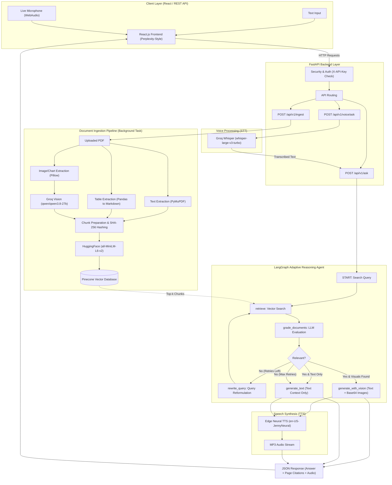
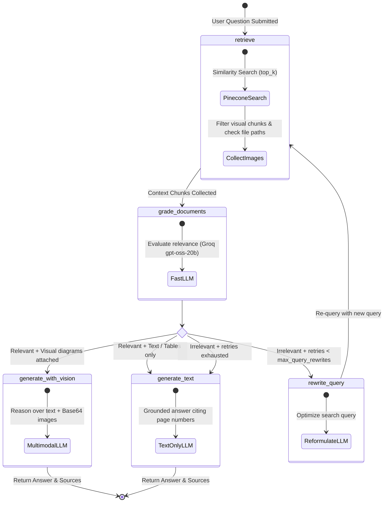

# Multimodal Agentic RAG

An Agentic Multimodal Retrieval-Augmented Generation (RAG) system built with **FastAPI**, **LangGraph**, **LangChain**, **Groq**, and **Pinecone**.

This application ingests PDF documents containing text, tables, and images/charts/diagrams, and answers user questions by reasoning over both textual and visual evidence using an intelligent agent workflow.

---

## System Architecture

### 1. End-to-End System & Data Flow


### 2. LangGraph Agent Decision State Machine


- **Extraction**: PyMuPDF extracts text, tables (converted to Markdown), and images.
- **Image Summaries**: Visuals are described by a vision model (`qwen/qwen3.8-27b`) during ingestion so they can be indexed semantically.
- **Embeddings & Vector Database**: Stored in Pinecone using `sentence-transformers/all-MiniLM-L6-v2`.
- **Adaptive Agent**: LangGraph dynamically routes queries, rewrites ambiguous questions, and passes original high-resolution visuals to the vision model when answering visual questions.

---

## Getting Started

### 1. Prerequisites
- Python 3.12+
- [uv](https://docs.astral.sh/uv/) package manager
- Pinecone API Key
- Groq API Key

### 2. Environment Setup
Copy `.env.example` to `.env` and fill in your keys:

```bash
cp .env.example .env
```

Set the following variables in `.env`:
```env
GROQ_API_KEY=your_groq_api_key
PINECONE_API_KEY=your_pinecone_api_key
API_KEY=your_secret_api_key
```

### 3. Install Dependencies
```bash
uv sync
```

---

## Running the Application

### 1. Start the FastAPI Backend
```bash
uv run multimodel-rag
```
Or with auto-reload:
```bash
uv run uvicorn multimodel_rag.main:app --reload --port 8000
```
- Access the **React Web UI** directly at: `http://127.0.0.1:8000`
- Access Swagger OpenAPI documentation at: `http://127.0.0.1:8000/docs`

### 2. Frontend Development Server (Optional)
If you wish to edit and develop the React components with Vite Hot-Module-Replacement (HMR):
```bash
cd frontend
npm run dev
```
Open `http://localhost:3000` to interact with the Vite dev server with automated backend proxying.

---

## Frontend Architecture 

The frontend is built with **React 18** and **Tailwind CSS**, styled using the Mediterranean architectural interior palette:

- **Palette**:
  - `med-700` (`#1a508b`): Deep Cobalt / Mediterranean Wall Blue
  - `med-950` (`#081525`): Shadow & Dark Navy Tile Accents
  - `cognac-600` (`#a05634`): Warm Cognac Leather Sofa (Voice Mode & Audio accents)
  - `chalk-100` (`#f9f8f6`): Warm Painted Wall Cream / Sand Neutral
  - `chalk-50` (`#ffffff`): Porcelain White (Cards & Glass Cabinets)

- **Two Conversation Modes**:
  1. **Text Conversation**: Perplexity-style query input, thread history, citation chips (`Page X | Text`, `Page Y | Table`, `Page Z | Visual`), and detailed Markdown reasoning.
  2. **Voice Conversation**: Direct live human microphone input via `MediaRecorder` API, real-time transcription via Groq Whisper, and auto-playback of the answer through Microsoft Edge Neural TTS.

---

## API Endpoints

All endpoints except `/health` require the `X-API-Key` header with your configured `API_KEY`.

### 1. Health Check (Public)
```http
GET /api/v1/health
```

### 2. Ingest PDF Document
Upload a PDF report for background extraction and indexing.
```http
POST /api/v1/ingest
Header: X-API-Key: <your-key>
Content-Type: multipart/form-data
Body: file=@report.pdf
```
Returns a `job_id` with status `queued`.

### 3. Check Ingestion Status
```http
GET /api/v1/jobs/{job_id}
Header: X-API-Key: <your-key>
```
Returns status (`queued`, `running`, `completed`, `failed`) and the number of stored chunks.

### 4. Ask a Question (Text)
```http
POST /api/v1/ask
Header: X-API-Key: <your-key>
Content-Type: application/json

{
  "question": "What was the revenue growth in Europe according to the charts?"
}
```

### 5. Ask with Voice (Voice-in & Voice-out)
Send an audio recording of your spoken question (`.wav`, `.mp3`, `.m4a`, etc.). The agent transcribes your voice, searches the PDF, and speaks the answer back.
```http
POST /api/v1/voice/ask
Header: X-API-Key: <your-key>
Content-Type: multipart/form-data
Body: file=@question.wav
```
Response format:
```json
{
  "transcribed_question": "What was the revenue growth in Europe?",
  "answer": "According to page 12, Europe showed a 24% revenue increase...",
  "audio_base64": "data:audio/mp3;base64,...",
  "used_vision": true,
  "query_rewrites": 0,
  "sources": [
    {
      "page": 12,
      "type": "visual",
      "preview": "Bar chart comparing revenue growth across regions..."
    }
  ]
}
```

### 6. Streaming Voice Output
Send a text query and get direct MP3 audio stream for playback.
```http
POST /api/v1/voice/speak
Header: X-API-Key: <your-key>
Content-Type: application/json

{
  "question": "Summarize the key financial takeaways."
}
```

---

## Running Tests

Execute the test suite using pytest:

```bash
uv run pytest
```
